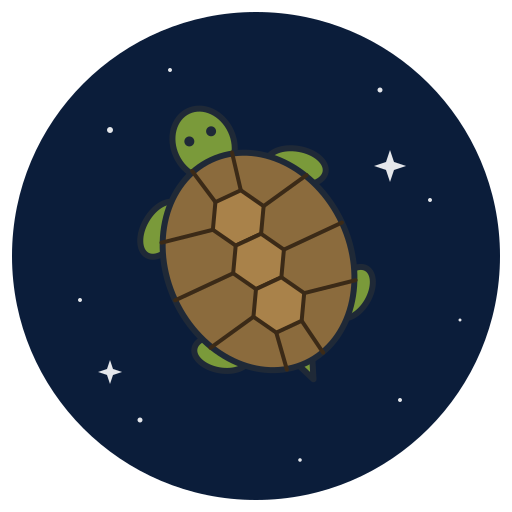

<p align="center">
  
</p>

# Wise Tortoise — Lunar Landing Site Navigator

> **If we land here, on this date, how long will we have sunlight and contact with Earth?**

Team Wise Tortoise's project for the [NASA Space Apps Challenge 2026: Lunar Landing Site Navigator](https://www.spaceappschallenge.org/2026/challenges/lunar-landing-site-navigator/).

**Live app:** https://lunar-landing-delta.vercel.app

## What it does

Pick a landing site (29 curated sites with sources, including NASA's 9 Artemis III candidate regions; a click on the south-pole map; or typed coordinates), a landing date and a mission length. The app answers:

- **Headline:** is the Sun up at touchdown, and how long until sunset (or sunrise)? Is Earth in view, and how long until Earthset?
- **Mission summary:** % of the mission sunlit, % with Earth contact, % with both.
- **Risk:** the longest dark period (battery/thermal survival) and the longest communication blackout.
- **Sky view:** the real terrain horizon with the Sun's and Earth's paths over the mission.
- **Timeline:** when the site is sunlit and when Earth is visible, and how far above the horizon each is.
- **Mission playback:** scrub or play through the mission and watch the Sun circle the horizon and Earth rise and set.
- **Comparison:** up to three scenarios side by side.
- **Best landing dates:** the same site and mission length for every landing day over the next year.
- **Solar power:** average sunlight on a vertical panel turned to the Sun vs a flat panel.
- **Shareable links:** the URL always reproduces the current scenario.

## How it works

1. **Sun and Earth positions** come from NASA JPL [Horizons](https://ssd.jpl.nasa.gov/horizons/): the sub-solar and sub-Earth points on the Moon every 30 minutes (2026–2030). Vector math turns them into sky positions for any site. Checked against Horizons' own lunar-surface answers to 0.006°.
2. **The local horizon** comes from LRO **LOLA** elevation maps: 720 rays out to 300 km on the curved Moon (20 m maps near curated south-pole sites, 120 m beyond; a bundled 240 m map for custom coordinates).
3. **Visibility:** the site is sunlit when the Sun's center is above the terrain in its direction; it has Earth contact when Earth's center is.

Full details and validation: [REFERENCE.md](REFERENCE.md). Build plan: [PLAN.md](PLAN.md).

## Stack

- **Frontend:** Next.js (App Router, TypeScript, Tailwind, shadcn/ui with the Luma style, Outfit font, Hugeicons, Observable Plot) in `frontend/`
- **Backend:** FastAPI + numpy (Python, uv) in `backend/`; all physics lives in `backend/lunar/` with a pytest suite
- **Hosting:** Vercel, one project with two [Services](https://vercel.com/docs/services) defined in `vercel.json`

## Run locally

Requirements: Node.js, [uv](https://docs.astral.sh/uv/), and the Vercel CLI (via `npx`).

```bash
cd frontend && npm install && cd ..
npx vercel dev --local
```

Open the URL the CLI prints. `/api/*` goes to FastAPI, everything else to Next.js.

Tests: `cd backend && uv run pytest -q`

## Data and references

- JPL Horizons System, NASA/JPL-Caltech Solar System Dynamics — https://ssd.jpl.nasa.gov/horizons/
- LRO LOLA Gridded Data Records (polar stereographic DEMs LDEM_75S_120M, LDEM_85S_20M), NASA GSFC / PDS Geosciences Node — https://imbrium.mit.edu/DATA/LOLA_GDR/POLAR/
- LOLA team, `DSMAP_POLAR.CAT` projection definition — https://imbrium.mit.edu/CATALOG/DSMAP_POLAR.CAT
- Site coordinates: cited per site in `backend/data/sites.json` (shown in the app)
- Site icon: "Lander Galaxy" by SVG Repo, CC0 — https://www.svgrepo.com/svg/275140/lander-galaxy
- Tools also listed by the challenge: [Quickmap](https://quickmap.lroc.asu.edu/), [Moon Trek](https://trek.nasa.gov/moon/)

Libraries: Next.js (MIT), React (MIT), Tailwind CSS (MIT), shadcn/ui (MIT), Radix UI (MIT), Hugeicons free icons (MIT), class-variance-authority (Apache-2.0), cn (MIT), tw-animate-css (MIT), Observable Plot (ISC), Outfit font (SIL OFL 1.1), FastAPI (MIT), numpy (BSD-3-Clause), truststore (MIT, data scripts only), pytest (MIT, tests only).

## Use of AI

This project was built with substantial help from Claude (Anthropic). What was AI-generated and what the team decided is logged in [AI_USE.md](AI_USE.md).

## License

Not chosen yet. If none is specified, NASA distributes Space Apps submissions under Apache-2.0.
